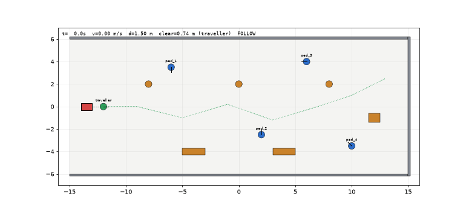

# Follow-Me Luggage Cart

A local simulation of a luggage cart following a traveler through an airport scene.

## Demo



[Open the demo GIF](out/run_20261114_144757.gif)

## Run the demo

From the repository root in PowerShell, with the project dependencies installed in `.venv`:

```powershell
$env:PYTHONPATH = "src"
.\.venv\Scripts\python.exe -m followme.main --offline --seed 42 --plot
```

The command saves run data, a summary plot, and an animated GIF in `out/`.
